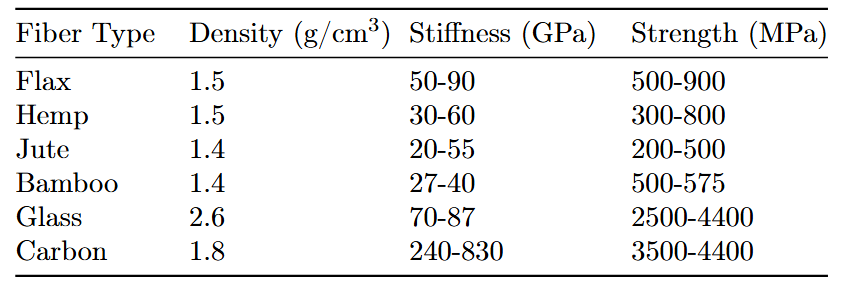
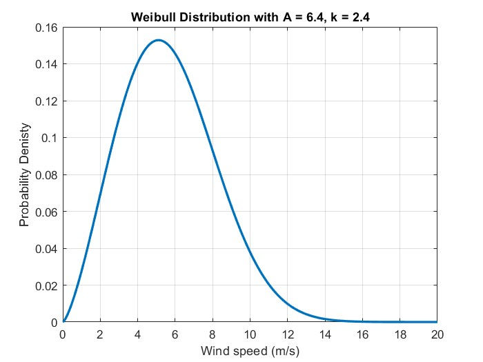
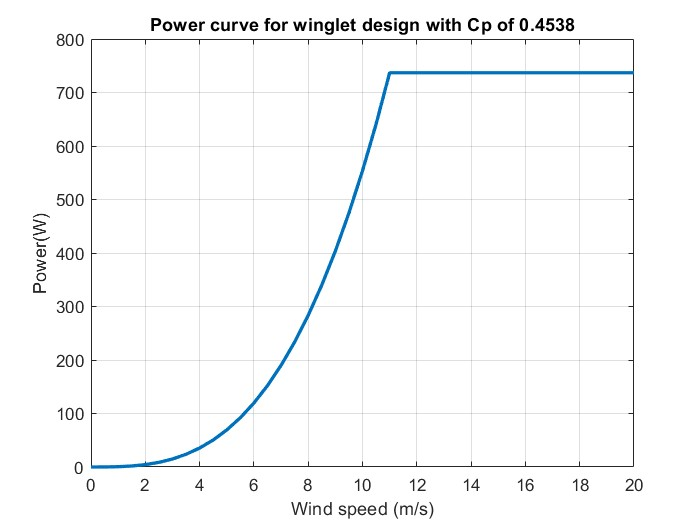

# Vegan Turbine — Student Wind Energy Project

Nantes, France | 2025

## 📌Overview

The Bio-Balde (Vegan Turbine) project was an engineering competition that challenged teams to design, manufacture, and evaluate a small-scale wind turbine. Our team investigated the potential of flax-fibre composites and bio-based resin as alternatives to conventional synthetic composite materials for wind turbine blades.

The project combined practical blade manufacturing, winglet design, wind-tunnel testing, and energy-yield assessment to explore the balance between aerodynamic performance, structural viability, and environmental sustainability.

My main contributions were composite material selection, blade manufacturing, experimental performance evaluation, and Annual Energy Production (AEP) assessment.

## 🏆Project Achievement
* **AEP Technical Award:** Recognised for the turbine's annual energy production performance.
* **Second Place Overall:** Achieved in the 2025 International Small Wind Turbine Contest.
* **Environmental Assessment:** Recognised for the team's sustainability assessment and consideration of environmental impacts across the turbine's life cycle.

The project demonstrated how material selection, blade design, experimental testing, and energy-yield analysis can be brought together in a small wind turbine development process.

## 🛠️ Tools & Methodologies

### 1. Blade Design and Winglet Configuration

Our team adopted a winglet-based blade design to investigate its potential to improve the aerodynamic performance of a horizontal-axis wind turbine.

Winglets were considered as a design approach to reduce blade-tip losses and improve aerodynamic efficiency. Their effectiveness, however, depends on the geometry, operating conditions, and associated aerodynamic and structural effects.

This design decision provided an opportunity to connect aerodynamic concepts with practical small-turbine development and performance evaluation.

### 2. Sustainable Composite Material Selection & Manufacturing

I was responsible for selecting the main composite reinforcement material and contributing to blade manufacturing. The team selected flax-fibre fabric combined with bio-based resin as an alternative to conventional synthetic composite materials.

Why flax fibre?

Flax fibre was selected for its renewable origin, potential environmental benefits, and mechanical properties relevant to lightweight structural applications.

Reported properties of flax fibres and flax-based composites vary significantly with fibre quality, fibre orientation, resin system, and manufacturing process. Under favourable conditions, flax-based materials can offer useful tensile strength and stiffness, although they generally do not match the specific mechanical performance of high-performance carbon-fibre composites.

This part of the project gave me practical exposure to composite material selection, blade fabrication, and the manufacturing considerations involved in applying sustainable materials to wind turbine structures.

Flax fiber has been selected as the reinforcement material for the turbine blade due to its favorable mechanical properties and reduced environmental impact. Studies on unidirectional flax yarns report effective stiffness values approaching 90 GPa and tensile strength ranging from 500 to 900 MPa, depending on fiber quality. While these values remain lower than those of carbon fiber, flax outperforms many other natural and synthetic alternatives in terms of sustainability and structural viability. 

### 3. Wind-Tunnel Testing

We tested the turbine in a wind-tunnel environment to observe its operation and evaluate its performance under controlled conditions.

The testing process helped connect the theoretical aspects of turbine aerodynamics with experimental observations and measured performance data.

My experience included working with the experimental setup, observing turbine behaviour, and relating the test results to the turbine's power-performance characteristics.

### 4. Annual Energy Production (AEP) Assessment

AEP was a key performance metric in the competition because it connects a turbine's power curve with the expected energy production at a particular wind site.

I contributed to the AEP assessment by examining the turbine's power curve in conjunction with a Weibull wind-speed distribution.

For the assessment, the site wind distribution was characterised using A = 6.4 and k = 2.4 . The Weibull distribution represents the probability of different wind speeds occurring at the selected site. Combining this distribution with the turbine's power curve allows the expected energy yield to be estimated.

The general AEP calculation is:

[
AEP = 8760\int_0^\infty P(v)f(v),dv
]

where:

* (P(v)) is the turbine power output at wind speed (v).

* (f(v)) is the Weibull probability density function.

* (8760) is the number of hours in a non-leap year.

This assessment highlighted the importance of evaluating turbine performance against site-specific wind conditions rather than relying solely on peak power coefficient or rated power.

Weibull wind-speed distribution used for the AEP assessment.

Power curve used to evaluate expected energy production.

## 🌱 Sustainability Assessment

Sustainability was an important part of the project, extending the evaluation beyond aerodynamic performance alone.

Our team considered the environmental implications of using flax-based reinforcement and bio-based resin in place of conventional blade composite materials. This approach encouraged us to consider material sourcing, manufacturing processes, structural performance, and potential environmental impacts across the turbine's life cycle.

The team achieved second place in the Sustainability Report, recognising this aspect of our work alongside the turbine's technical performance.

The project reinforced an important engineering principle: a material alternative should not be considered sustainable solely because it is bio-based or renewable. Its environmental benefits must be assessed alongside durability, manufacturing requirements, service life, and end-of-life considerations.

## 💡Key Learnings & Takeaways
This project strengthened my understanding of how different aspects of wind turbine development interact, from material selection and blade manufacturing to aerodynamic testing and energy-yield assessment.

### Key takeaways:

* Composite engineering: Gained hands-on experience in selecting flax-fibre reinforcement and manufacturing small wind turbine blades.

* Aerodynamic design: Explored winglet configurations and their potential influence on turbine performance.

* Experimental validation: Connected wind-tunnel observations and measured performance with theoretical expectations.

* Wind resource assessment: Applied Weibull wind-speed modelling and power-curve analysis to estimate AEP.

* Sustainability and life-cycle thinking: Considered the environmental implications of alternative blade materials and the broader trade-offs involved in sustainable engineering.

* Team-based engineering: Contributed to a multidisciplinary project that balanced technical performance, manufacturing feasibility, and sustainability objectives.
